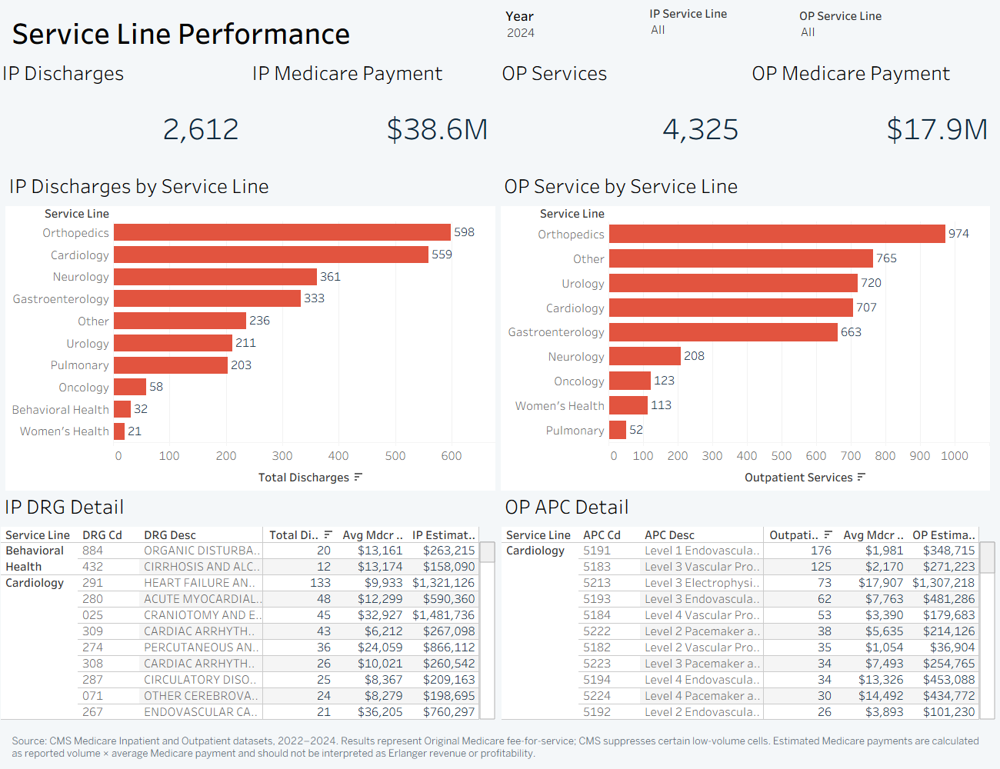
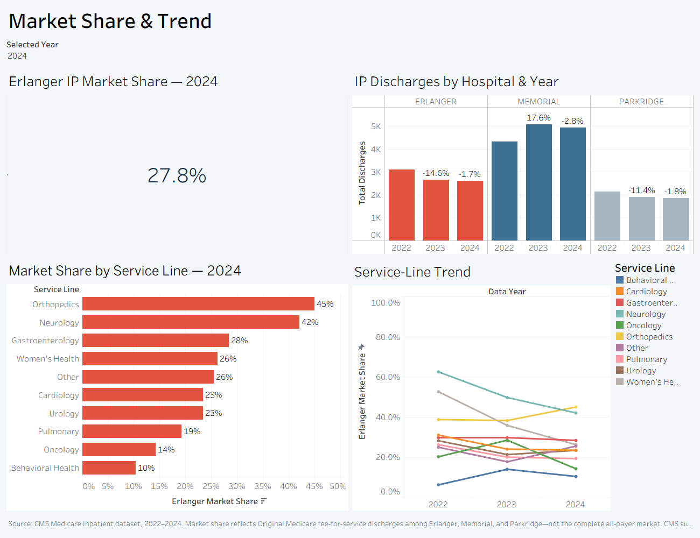
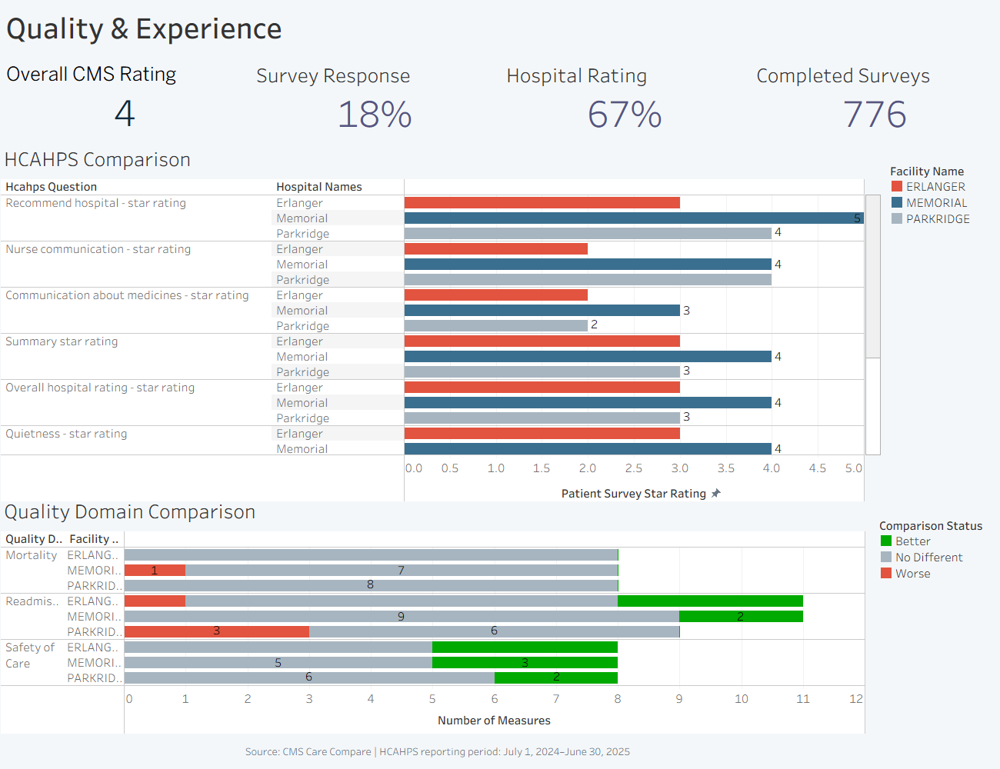
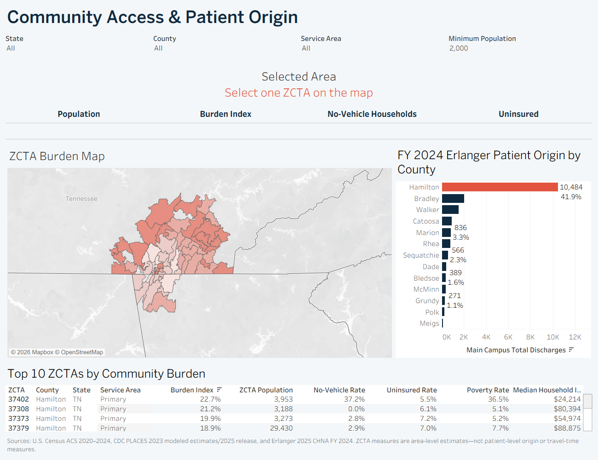
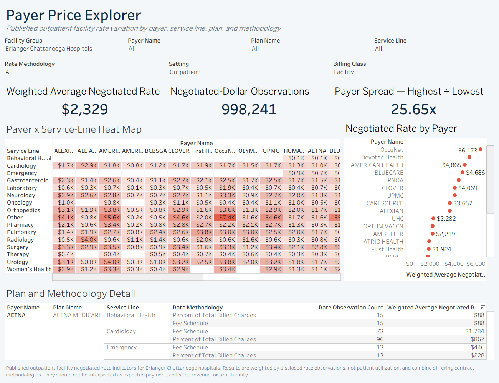

# Erlanger Health System Strategic Analytics

An independent healthcare analytics portfolio project examining Medicare utilization, service-line market position, community access, quality, patient experience, and publicly posted negotiated rates in the Chattanooga service area.

## Explore the project

| Resource | What it provides |
| --- | --- |
| **[Interactive Tableau Public workbook →](https://public.tableau.com/views/ErlangerHealthSystemStrategicAnalytics/ServiceLinePerformance)** | Five interactive dashboards with filters, tooltips, and dashboard actions |
| **[Dashboard portfolio PDF](docs/erlanger-dashboard-portfolio.pdf)** | Printable, five-page snapshot of the completed dashboards |
| **[Executive strategic-analysis presentation](docs/Erlanger%20Service%20Line%20Growth%20%26%20Community%20Access.pdf)** | Executive findings, recommendations, and decision context |
| **[Project data dictionary](data/data-dictionary.xlsx)** | Table grains, 229 source fields, logical relationships, calculations, sources, limitations, and validation benchmarks |
| **[Packaged Tableau workbook](tableau/erlanger-health-system-strategic-analytics.twbx)** | Downloadable `.twbx` containing the five dashboards and six packaged extracts |

> **Portfolio disclosure:** This project was independently developed from publicly available information. It was not commissioned, sponsored, reviewed, or endorsed by Erlanger, and it does not contain confidential internal Erlanger data. Estimated payment totals, service-line assignments, market-share calculations, community burden scores, payer-rate summaries, and strategic scenarios are analyst-constructed. CDC PLACES values are model-based estimates, and American Community Survey values are survey estimates.

## Dashboard gallery

Click any dashboard image to open the interactive Tableau workbook.

### 1. Service Line Performance

Examines inpatient and outpatient utilization, estimated Medicare payments, year-over-year trends, and service-line drill-downs.

[](https://public.tableau.com/views/ErlangerHealthSystemStrategicAnalytics/ServiceLinePerformance)

### 2. Market Share & Trend

Evaluates Erlanger's Original Medicare inpatient position relative to Memorial and Parkridge by service line and year.

[](https://public.tableau.com/views/ErlangerHealthSystemStrategicAnalytics/ServiceLinePerformance)

### 3. Quality & Experience

Compares CMS quality-domain results, overall ratings, and HCAHPS patient-experience measures.

[](https://public.tableau.com/views/ErlangerHealthSystemStrategicAnalytics/ServiceLinePerformance)

### 4. Community Access Map

Combines community-health estimates, population and transportation barriers, service-area roles, and patient-origin patterns.

[](https://public.tableau.com/views/ErlangerHealthSystemStrategicAnalytics/ServiceLinePerformance)

### 5. Payer Price Explorer

Explores published outpatient facility negotiated rates by payer, plan, service line, methodology, setting, and billing class.

[](https://public.tableau.com/views/ErlangerHealthSystemStrategicAnalytics/ServiceLinePerformance)

## Strategic business problem

The project addresses a practical health-system strategy question:

**Where does the available public evidence indicate that Erlanger could defend a strong service line, recapture lost Medicare volume, improve community access, strengthen patient experience, or investigate payer-rate variation?**

The analysis compares Erlanger (CCN 440104) with Memorial and Parkridge for Original Medicare fee-for-service activity. It then adds community need, patient-origin, quality, patient-experience, and price-transparency context. The goal is to create a decision-support baseline—not to represent Erlanger's complete market, internal operating performance, profitability, or strategic plan.

## Executive summary

- **Inpatient position weakened while outpatient activity held steady.** Public CMS cells sum to 3,399 Erlanger inpatient discharges in 2024, down 12.9% from 2022, while outpatient activity remained near 4,325 services. These totals exclude CMS-suppressed low-volume cells.
- **Estimated Medicare payments remained near $71.1 million.** This is a constructed estimate: approximately $53.2 million inpatient plus $17.9 million outpatient, calculated from reported utilization and average Medicare payment fields. It is not Erlanger-reported revenue or a financial-statement value.
- **Orthopedics is the strongest demonstrated opportunity.** The analyst-defined service line produced 598 inpatient discharges, a constructed 45.0% share of the three-hospital Medicare comparison market, and approximately $5.6 million in estimated outpatient Medicare payments.
- **Cardiology is the largest visible inpatient recapture opportunity.** Erlanger recorded 559 classified cardiac discharges versus 1,340 at Memorial, giving Erlanger a constructed 23.5% share. Outpatient electrophysiology and ICD activity suggests that some care may have shifted setting, but referral leakage cannot be proven from these files alone.
- **The sharpest access gap appears in the urban core.** Five Hamilton County ZCTAs—37402, 37404, 37406, 37407, and 37410—contain about 45,000 residents and combine high modeled disease prevalence with poverty and limited vehicle access. This identifies a planning priority; it does not establish that those residents are Erlanger patients.
- **Quality is broadly competitive, but patient experience trails.** CMS reported Erlanger at four overall stars versus five for Memorial. In the reviewed HCAHPS period, 67% of Erlanger respondents rated the hospital 9 or 10, compared with 76% at Memorial, and Erlanger received two stars for nurse communication and cleanliness.
- **Public negotiated rates show dispersion, not profitability.** After limiting the analysis to Chattanooga outpatient facility rates and payers with at least 30 observations, average-rate spreads were about fivefold for oncology and behavioral health. These public rates use different contract methodologies and do not prove that any payer is underpaying.

## Market-share and service-line opportunities

| Service line | Public-data signal | Strategic interpretation | Evidence status |
| --- | --- | --- | --- |
| Orthopedics and spine | 598 classified inpatient discharges; 45.0% constructed share; about $5.6M estimated outpatient payments | Protect and selectively scale the strongest demonstrated position | Strongest support in the available Medicare data; capacity constraints remain untested |
| Cardiology and vascular | 559 classified discharges versus Memorial's 1,340; 23.5% constructed share | Audit referral pathways and evaluate inpatient recapture while accounting for outpatient migration | The volume gap is supported; its causes are not |
| Behavioral health | 32 classified Erlanger discharges; 10.4% constructed share; high modeled depression prevalence across the region | Evaluate a build, access, or partnership strategy | Need and market gap are visible; demand, capacity, and economics require additional data |
| Oncology and hematology | 58 classified discharges; 14.3% constructed share; Memorial recorded 310 classified cases | Assess referral capture, screening, and partnership opportunities | Medicare gap is supported; all-payer demand is not measured |
| Women's health | 21 Medicare inpatient discharges in the constructed service line | Obtain all-payer or state discharge data before drawing a growth conclusion | Original Medicare is structurally unsuitable for measuring most obstetric demand |

The project uses **market share** to mean Erlanger's share of reported Original Medicare activity across the three selected Chattanooga hospitals. It is not total regional market share.

## Community access considerations

The community analysis uses two complementary views:

1. **County view:** Rural counties such as Sequatchie, Bledsoe, Rhea, and Grundy show high modeled chronic-disease burden but account for a relatively small share of main-campus discharges reported in the 2025 Erlanger Community Health Needs Assessment.
2. **ZCTA view:** County averages conceal substantial within-county variation. Hamilton County contains both the highest-burden ZCTA in the service area, 37410, and the lowest among the included ZCTAs, 37350.

The access finding is therefore more specific than “rural communities have greater need.” The available estimates point to both a high-need rural rim and a concentrated urban-core access problem near the main campus. Transportation support, neighborhood access points, screening, and community partnerships are reasonable strategies to test, but the public data do not predict utilization or return on investment.

## Quality and payer context

### Quality and patient experience

- CMS quality measures show no Erlanger mortality measure worse than the national rate in the reviewed release.
- Erlanger and Memorial each performed better than the national rate on three safety-of-care measures in the extracted comparison.
- Erlanger's clearest measured competitive gap was patient experience, particularly nurse communication, cleanliness, medication counseling, and the percentage of respondents assigning a 9 or 10 rating.
- HCAHPS results are survey-based. Response rates, completed survey counts, reporting periods, and CMS measurement lag must accompany the comparison.

### Payer-rate context

The negotiated-rate analysis uses publicly posted hospital price-transparency files. It applies the following rules before comparing payer averages:

1. Chattanooga-area Erlanger hospitals only.
2. Outpatient setting only.
3. Facility rates only; professional rates excluded.
4. Payers with at least 30 rate observations.
5. Spread calculated as the highest qualifying payer average divided by the lowest.

The resulting values are **constructed analytical summaries**, not confidential contract information, actual allowed amounts, collected revenue, patient out-of-pocket costs, or profit. Fee schedules, case rates, per-diem rates, and percentages of billed charges are not directly comparable without contract-level review.

## Data-model design

The Tableau model uses logical relationships instead of one large physical join because each table has a different grain. This prevents duplication of discharges, services, payment estimates, quality measures, county values, or ZCTA estimates.

| Primary table and grain | Related table | Relationship key | Purpose |
| --- | --- | --- | --- |
| Inpatient DRG: hospital × year × DRG | Facility Quality | `Rndrng_Prvdr_CCN` ↔ `facility_id` | Add hospital attributes and quality context without changing DRG grain |
| Inpatient DRG | Service Line Rules | `service_line` | Preserve an auditable record of the analyst-created keyword classification |
| Outpatient Volume: hospital × year × APC | Facility Quality | `Rndrng_Prvdr_CCN` ↔ `facility_id` | Compare outpatient activity with the same facility context |
| HCAHPS: facility × measure × period | Facility Quality | `facility_id` | Benchmark patient-experience measures in a consistent facility filter context |
| ZIP Access: ZCTA × metric × estimate type | Patient Origin | `county_fips` | Add county patient-origin context to ZCTA-level need estimates |
| Community Health: county × metric | Standalone logical table | None | Preserve county-level health estimates without duplicating ZCTA or patient-origin values |
| Facility Quality quality-domain fields | Standalone pivoted view | `facility_id` retained as the facility identifier | Compare better, no-different, and worse measure counts by quality domain |
| Negotiated Rates: payer × service description × rate methodology | Standalone logical table | None | Prevent millions of public rate observations from duplicating utilization records |
| Market Summary: hospital × year | Standalone summary table | None | Provide a stable hospital-year comparison without replacing the detailed inpatient source |
| Service Line Summary: service line × latest year | Standalone summary table | None | Provide a latest-year service-line snapshot; use Inpatient DRG for longitudinal trends |

The outpatient source table does not contain an official service-line field. The Tableau workbook therefore uses an analyst-created keyword classification documented in the data dictionary. It should be validated with clinical leadership before operational use.

## Analytical calculations

| Calculation | Definition | Classification |
| --- | --- | --- |
| Estimated Medicare payment | Reported utilization count × reported average Medicare payment for each DRG or APC cell, then summed | Constructed estimate |
| Three-hospital discharge share | Erlanger classified discharges ÷ classified discharges across Erlanger, Memorial, and Parkridge | Constructed estimate |
| Service-line assignment | First matching keyword rule applied to DRG descriptions; outpatient classification must be created separately | Analyst-created grouping |
| Community burden index | Mean modeled crude prevalence of coronary heart disease, diabetes, COPD, stroke, high blood pressure, obesity, and depression | Constructed index from modeled estimates |
| Payer-rate spread | Highest qualifying payer average ÷ lowest qualifying payer average after the stated filters | Constructed summary |
| Cardiology 10-point share scenario | Incremental discharges under a hypothetical share shift × average estimated Medicare payment | Simulated what-if scenario, not a forecast |

## Five-dashboard Tableau design

| Dashboard | Business question | Primary content |
| --- | --- | --- |
| Service Line Performance | Which services drive volume and estimated payments? | Inpatient DRGs, outpatient APCs, year selector, and drill-down |
| Market Share & Trend | Where is Erlanger gaining or losing position? | Three-hospital comparison by service line and year |
| Quality & Experience | Where does Erlanger lead or trail peers? | CMS stars, quality measure groups, and HCAHPS comparisons |
| Community Access Map | Where do disease burden and access barriers overlap? | County need, ZCTA estimates, vehicle access, poverty, and patient origin |
| Payer Price Explorer | Where do public negotiated-rate summaries vary most? | Payer, service line, methodology, qualifying observation count, and spread |

Refresh timing follows each source: CMS utilization annually, CMS quality and HCAHPS on their release cycles, CDC PLACES annually, ACS with its published estimate period, the CHNA on its organizational cycle, and price-transparency data with each machine-readable-file refresh. Each view should show its own as-of date.

## Executive recommendations

| Priority | Recommendation | What the data supports | What must still be validated |
| --- | --- | --- | --- |
| 1 | Audit cardiology referrals and recapture opportunities | A large classified Medicare discharge gap versus Memorial and a stronger outpatient cardiac signal | Referral sources, physician capacity, transfer patterns, payer mix, and the portion attributable to site-of-care migration |
| 2 | Protect and extend orthopedics | Strong inpatient share and the largest outpatient musculoskeletal payment estimate | OR capacity, clinic access, physician availability, wait times, contribution margin, and all-payer demand |
| 3 | Improve nurse communication and cleanliness | Two-star HCAHPS results and weaker patient-experience scores than peers | Unit-level drivers, staffing conditions, intervention design, and whether improvements affect the overall CMS rating |
| 4 | Test urban-core access interventions | Concentrated modeled disease burden, poverty, uninsurance, and limited vehicle access in five nearby ZCTAs | Actual Erlanger utilization, avoidable ED use, preferred access channels, partner capacity, and intervention economics |
| 5 | Review payer-rate outliers | Wide constructed dispersion in publicly posted outpatient facility rates | Contract comparability, volume, case mix, carve-outs, actual allowed amounts, and net revenue |

The presentation's statement that a 10-percentage-point cardiology share shift could represent about $4 million in inpatient Medicare payments is a **simulated scenario based on 2024 public averages**. It is not a forecast, commitment, savings estimate, or internally validated business case.

## What is directly supported—and what is not

| Supported by the reviewed public data | Not established by this project |
| --- | --- |
| Reported CMS DRG/APC utilization cells and average payment fields | Complete hospital census or all-payer market size |
| CMS quality ratings, measure-group results, and HCAHPS survey results | Current internal quality performance beyond CMS reporting lag |
| Erlanger CHNA patient-origin figures as publicly reported | Patient-level origin, referral behavior, or service-line profitability |
| Published CDC PLACES and ACS estimates for community areas | Diagnoses or access barriers among actual Erlanger patients |
| Public machine-readable negotiated-rate records | Confidential contracts, actual paid claims, collected revenue, cost, or margin |
| Constructed three-hospital comparisons using a stated scope | Total Chattanooga competitive market share |
| Observable gaps that justify further investigation | Causation, guaranteed growth, capacity availability, or return on investment |

## Data limitations

- **Original Medicare only:** CMS inpatient and outpatient utilization files exclude Medicare Advantage, commercial, Medicaid, and self-pay activity.
- **Suppressed low-volume cells:** CMS suppresses small DRG and APC cells, so summed totals understate activity and should not be treated as full census totals.
- **Not unique patients:** Outpatient beneficiary or service counts summed across APCs may count the same person more than once.
- **Estimated payments:** Aggregate payment totals are calculated from public utilization and average payment fields; they are not reported net revenue.
- **Analyst-defined service lines:** Keyword rules are an analytical construct, not an official CMS or Erlanger grouping. First-match logic can misclassify cases.
- **Restricted market definition:** The comparison includes Erlanger, Memorial, and Parkridge reporting hospitals, not every provider or care setting in the region.
- **Modeled and survey estimates:** CDC PLACES uses small-area modeling, while ACS figures are multi-year survey estimates. Neither is a patient-level count.
- **ZCTA geography:** ZCTAs are Census statistical areas and are not identical to USPS ZIP codes.
- **Mixed populations:** The CHNA patient-origin table is all-payer and combines adult and children's hospital discharges, while the utilization analysis is Original Medicare.
- **Quality reporting lag:** CMS quality and HCAHPS results reflect defined reporting periods and may lag current operations.
- **Price-methodology differences:** Negotiated rates may be expressed as fee schedules, case rates, per-diem amounts, or percentages of billed charges. A spread is a screening signal, not proof of underpayment.
- **Facility aggregation:** Chattanooga campuses report together under CCN 440104 in the Medicare files, and the consolidated price file may not identify the individual hospital to which a rate applies.
- **No causal inference:** Public descriptive data can identify patterns and hypotheses but cannot determine why volume changed or prove that a recommendation will produce growth.

## Public data sources

- [CMS Medicare Inpatient Hospitals by Provider and Service](https://data.cms.gov/provider-summary-by-type-of-service/medicare-inpatient-hospitals/medicare-inpatient-hospitals-by-provider-and-service), 2022–2024.
- [CMS Medicare Outpatient Hospitals by Provider and Service](https://data.cms.gov/provider-summary-by-type-of-service/medicare-outpatient-hospitals/medicare-outpatient-hospitals-by-provider-and-service), 2022–2024.
- [CMS Hospital General Information](https://data.cms.gov/provider-data/dataset/xubh-q36u), extracted August 11, 2026.
- [CMS HCAHPS—Patient Survey, Hospital](https://data.cms.gov/provider-data/dataset/dgck-syfz), reviewed for the July 1, 2024–June 30, 2025 survey period.
- [CDC PLACES](https://www.cdc.gov/places/index.html), 2024 county and ZCTA releases. PLACES values are model-based estimates.
- [U.S. Census Bureau ACS 5-Year Data](https://www.census.gov/data/developers/data-sets/acs-5year.html), 2020–2024 estimates.
- [Erlanger 2025 Community Health Needs Assessment](https://www.erlanger.org/about-us/community-impact), including the public FY 2024 patient-origin table.
- [Erlanger Price Transparency](https://www.erlanger.org/patient-and-family-resources/billing-and-insurance/price-transparency), machine-readable files with rates as of September 30, 2025.

## Repository contents

```text
erlanger-healthcare-analytics/
├── README.md
├── assets/
│   ├── dashboard-01-service-line-performance.png
│   ├── dashboard-02-market-share-trend.png
│   ├── dashboard-03-quality-experience.png
│   ├── dashboard-04-community-access-map.png
│   └── dashboard-05-payer-price-explorer.png
├── docs/
│   ├── erlanger-dashboard-portfolio.pdf
│   └── erlanger-strategic-analysis.pdf
├── data/
│   └── data-dictionary.xlsx
└── tableau/
    └── erlanger-health-system-strategic-analytics.twbx
```

## Skills demonstrated

- Healthcare market and service-line analysis
- Tableau logical relationship modeling across mixed data grains
- Calculated fields, parameters, filters, dashboard actions, and drill-down design
- Public-data validation and transparent treatment of estimates
- Medicare utilization and payment interpretation
- Community-health and access analysis
- Quality, HCAHPS, and competitive benchmarking
- Hospital price-transparency analysis
- Executive synthesis, recommendation development, and limitation disclosure

## Appropriate use

This work is suitable as a public-data portfolio demonstration and as a starting point for further analysis. Before any investment, contracting, capacity, referral, or community-access decision, the findings should be validated with all-payer claims or discharge data, internal encounter and referral data, capacity and workforce information, contract-level detail, finance-reviewed economics, and clinical leadership review of the service-line classification.
